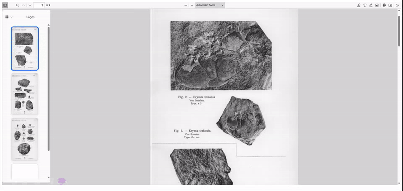

# 📄 PDF Web Viewer

PDF Web Viewer is a lightweight wrapper around the official PDF.js viewer for simple PDF previews in web apps. The project exposes a small API to create a viewer instance and mount it into your page.

## 🚀 Quick Start

1. Add a container to your HTML document where the viewer will be mounted:

   ```html
   <div class="pdf-container"></div>
   ```

2. Install the package (if published to a registry):

   ```bash
   pnpm add pdf-web-viewer
   # or
   npm install pdf-web-viewer
   # or
   yarn add pdf-web-viewer
   ```

3. Use the library according to your project type.

   #### ESM Projects

   ```js
   import { create } from 'pdf-web-viewer'

   const container = document.querySelector('div.pdf-container')

   // Option A: relative path (resolved against location.origin)
   const viewer = create('/assets/sample.pdf', { width: '800px', height: '600px' })
   viewer.mount(container)

   // Option B: absolute URL
   const viewer = create('https://example.com/files/document.pdf', {
     width: '100%',
     height: '100%',
   })
   viewer.mount(container)
   ```

   #### Non-ESM Projects

   If you build a UMD bundle that exposes a `PdfViewer` global, use it like:

   ```html
   <script src="node_modules/pdf-web-viewer/dist/index.umd.js"></script>
   <script>
     window.onload = function () {
       // Accepts a relative path or an absolute URL (http/https)
       const viewer = PdfViewer.create('/assets/sample.pdf')
       viewer.mount(document.querySelector('div.pdf-container'))
     }
   </script>
   ```

## ▶️ Live Demo

Try it instantly — no setup required:

> **[Open the playground →](https://julioolivares.github.io/pdf-web-viewer/)**

The playground lives in the self-contained [`example/`](example/) folder (page, sample PDF and a prebuilt copy of the library in `example/lib/`). It is deployed as-is to GitHub Pages by [`.github/workflows/pages.yml`](.github/workflows/pages.yml).

To run it locally:

```bash
pnpm install
pnpm dev:example   # serves ./example at http://localhost:6790
```

After changing the library, refresh the prebuilt copy and commit it:

```bash
pnpm build:example
```

## 🎥 Gif Demo



## 🛠️ API Overview

### `create(filePath: string, options?: { width?: string; height?: string; displayPagePanel?: boolean; viewerPath?: string }): PdfWebViewer`

Creates a viewer instance and returns it. The instance exposes the `mount` and `setFile` methods.

- `filePath` (string): Path or URL of the PDF file to display. Two formats are accepted:
  - **Relative path** — e.g. `'/assets/sample.pdf'`. Resolved to an absolute URL using `location.origin`.
  - **Absolute URL** — e.g. `'https://example.com/files/document.pdf'`. Used directly (URL-encoded before being passed to the viewer).

  The value must end with `.pdf` (case-insensitive), otherwise an `Error` is thrown.

- `options` (optional):
  - `width` (string) — width of the PDF viewer; default: `100%`.
  - `height` (string) — height of the PDF viewer; default: `100%`.
  - `displayPagePanel` (boolean) — when `true`, opens the viewer with the thumbnail panel visible; default: `false`.
  - `viewerPath` (string) — path or URL of the bundled PDF.js `viewer.html`. Relative paths are resolved against `document.baseURI`. Use it when the files are not served from `/node_modules/pdf-web-viewer/dist/web/viewer.html` at the site root (e.g. a GitHub Pages project site or a production bundle); default: `` `${location.origin}/node_modules/pdf-web-viewer/dist/web/viewer.html` ``. The viewer must be served from the same origin as the PDF.

    ```js
    const viewer = create(new URL('assets/sample.pdf', document.baseURI).href, {
      viewerPath: 'vendor/pdf-web-viewer/web/viewer.html',
    })
    ```

#### Methods

- `mount(targetElement: HTMLElement): void`
  - Adds the PDF viewer into `targetElement`. Throws an `Error` if `targetElement` is not provided.

- `setFile(filePath: string): void`
  - Updates the viewer to load a new PDF. Accepts the same relative paths and absolute URLs (`http`/`https`) as `create`. The `filePath` must be provided and must end with `.pdf`, otherwise an `Error` is thrown.

## Error handling

- `create` and `setFile` will throw an `Error` if the provided `filePath` is missing or does not end with `.pdf`.
- `mount` will throw if a valid mount target is not provided.

> **Note on CORS:** when using absolute URLs pointing to a different origin, the remote server must allow cross-origin requests, otherwise the browser will block the PDF from loading.

## 📚 Additional resources

For advanced usage and detailed API references, see the [official PDF.js documentation](https://mozilla.github.io/pdf.js/).

## 🙏 Acknowledgments

Thanks to the Mozilla team and the PDF.js project for their excellent work and for providing a robust viewer that this package builds on.
